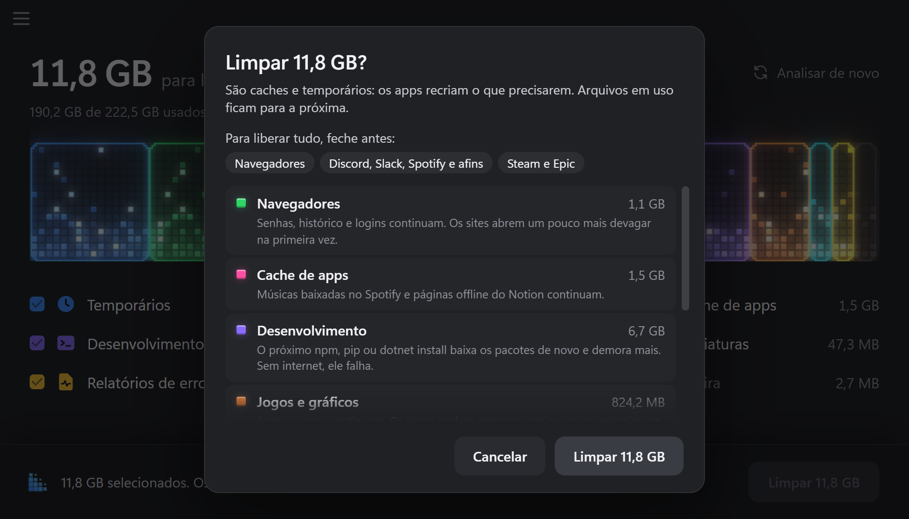

<div align="center">


# Vanish

**Limpa arquivos temporários e caches do Windows, mostrando antes exatamente o que vai sumir.**

Electron · TypeScript · Windows 10/11

<a href="https://github.com/Eduardo-Virissimo/vanish/releases/latest/download/Vanish-Setup.exe"></a>

<sub>Instala em segundos, sem pedir administrador, e se atualiza sozinho. <a href="https://github.com/Eduardo-Virissimo/vanish/releases">Todas as versões</a></sub>

</div>


## Por que eu fiz

Eu cansei de ver o disco enchendo sem saber **onde** estavam os arquivos que pesavam no meu PC.
Os limpadores que eu achava ou não mostravam nada (só um botão "limpar" e torcer para não apagar
algo importante), ou vinham cheios de propaganda, "otimizador de registro" e coisas que eu não
confiava. Então fiz o meu: um app que mostra exatamente o que ocupa espaço, de onde vem, e só
apaga o que os programas recriam sozinhos.

## Feito com IA

O Vanish foi feito por mim com a ajuda de IA (**Claude**, da Anthropic), que escreveu boa parte do
código sob a minha direção. A IA não trabalha solta: o projeto tem regras escritas que ela (e
qualquer pessoa) precisa seguir antes de mexer em qualquer coisa ([AGENTS.md](AGENTS.md)), e nada
entra sem passar pelas verificações abaixo. As decisões de produto, visual e o que pode ou não ser
apagado são minhas.

## Seguro e sem vírus

Um limpador apaga arquivos, então segurança vem antes de tudo. Você não precisa acreditar na minha
palavra: dá para conferir.

- **Código aberto.** Todo o código está aqui. O instalador é gerado pelo próprio GitHub
  ([Actions](.github/workflows/release.yml)) a partir deste código público, não no meu PC.
- **Sem coleta de dados, sem propaganda.** O app só se conecta à internet para procurar versões
  novas nas [releases deste repositório](https://github.com/Eduardo-Virissimo/vanish/releases).
  Nada sobre você ou seu PC é enviado. Erros ficam num registro só no seu PC
  (`%APPDATA%\Vanish\logs\vanish.log`), para você mandar se quiser relatar um problema.
- **Lista fechada e auditada.** Cada pasta que pode ser limpa tem fonte e justificativa na
  [auditoria de segurança](docs/SAFETY-AUDIT.md). Sem fonte confiável, não entra.
- **Travas no próprio app**, checadas na análise e de novo na hora de apagar:
  - só apaga o conteúdo de pastas da lista, nunca a pasta em si, e nunca segue atalhos ou junções
    para fora dela;
  - confere no seu PC se cada pasta está mesmo no lugar esperado (se uma variável como `TEMP`
    estiver apontando para o disco inteiro, a categoria é bloqueada em vez de apagar tudo);
  - temporários só com mais de 24 h, pela data de criação (instaladores rodando não são afetados);
  - arquivos em uso são pulados; Windows Update fica bloqueado com reinício pendente;
  - arquivos que um instalador agendou para o próximo reinício nunca são apagados;
  - se o "Abrir como administrador" cair na conta de outra pessoa, o app avisa antes;
  - a tela não tem acesso ao disco e só consegue pedir categorias conhecidas; pedidos que não
    vêm da própria tela do app são recusados, e permissões como câmera ou notificações são negadas.
- **Testes automáticos em toda mudança** ([CI](.github/workflows/ci.yml)): as regras de segurança
  de todas as categorias, o motor de limpeza rodando em pastas falsas (nunca no PC de verdade) e
  casos como `TEMP=C:\`. Uma versão só é publicada se tudo passar.
- **TypeScript estrito**, revisão de cada mudança e documentação de como o app funciona
  ([arquitetura](docs/ARCHITECTURE.md)).

O instalador ainda **não é assinado** digitalmente (certificado é pago), por isso o Windows pode
avisar na primeira vez; veja [Instalar](#instalar).

## O que o Vanish faz diferente

Limpadores costumam ser uma caixa-preta: você clica e espera que não tenham apagado nada importante.
O Vanish faz o contrário:

- **Lista fechada e auditada.** Só apaga caches e temporários conhecidos, cada pasta revisada com
  fonte na [auditoria de segurança](docs/SAFETY-AUDIT.md).
- **Você vê as pastas reais.** O menu ☰ mostra cada pasta encontrada no seu PC, com o tamanho e a
  regra que se aplica; um clique abre no Explorador para conferir.
- **Confirmação que explica.** Antes de apagar, cada categoria aparece com o que vai acontecer
  e o que precisa estar fechado ("feche antes: Steam e Epic"). Só caches: confirmação leve. O que
  não volta, como a Lixeira, fica em vermelho e pede "Entendi".
- **Travas de segurança.** Nunca segue atalhos ou junções para fora das pastas, pula arquivos em
  uso, mantém temporários recentes e bloqueia o Windows Update quando há atualização esperando
  reiniciar.




## O que ele limpa

| Categoria | O que entra | Começa marcada? |
|---|---|---|
| **Temporários** | `%TEMP%` e `C:\Windows\Temp`, só arquivos com mais de 24 h | sim |
| **Navegadores** | cache do Chrome, Edge, Brave, Opera e Firefox (senhas, histórico e logins ficam) | sim |
| **Cache de apps** | Discord, VS Code, Slack, Teams, Spotify, Notion, Obsidian, Postman | sim |
| **Desenvolvimento** | cache do npm, Yarn, pip, NuGet, Go, Electron, node-gyp e Composer | sim |
| **Jogos e gráficos** | shaders do DirectX, NVIDIA e AMD; cache web da Steam e da Epic | sim |
| **Miniaturas** | `thumbcache_*.db` e `iconcache_*.db` do Explorador | sim |
| **Relatórios de erro** | relatórios e despejos de travamentos antigos | sim |
| **Windows Update** | downloads de atualizações já instaladas | **não** (e bloqueado com reinício pendente) |
| **Lixeira** | tudo o que está na lixeira, em todos os discos | **não** |

O que ficou de fora de propósito (e por quê) está em [candidatos](docs/CLEANUP-CANDIDATES.md).

## Instalar

Clique em **Baixar para Windows** no topo (ou baixe o **`Vanish-Setup.exe`** da [última release](https://github.com/Eduardo-Virissimo/vanish/releases/latest))
e abra. Ele instala em segundos, só para o seu usuário (sem pedir administrador), e já abre o app.

- **Atualiza sozinho:** o Vanish confere o GitHub ao abrir, baixa a versão nova em segundo plano e
  instala quando você fecha. Para instalar na hora, clique em **Atualizar para x.y.z** no topo.
- O instalador **ainda não é assinado**. Com o "Controle Inteligente de Aplicativos" do Windows 11
  ligado, ele é bloqueado; sem ele, o Windows mostra "O Windows protegeu o computador": clique em
  **Mais informações → Executar assim mesmo**. Para usar com o Controle Inteligente ligado é preciso
  desligá-lo (Segurança do Windows → Controle de aplicativos e navegador).
- Para desinstalar, veja [Desinstalar](#desinstalar) logo abaixo.

Como publicar uma versão nova: [docs/RELEASE.md](docs/RELEASE.md).

## Desinstalar

1. **Configurações do Windows → Aplicativos → Aplicativos instalados → Vanish → Desinstalar.**
   Não precisa de administrador. Feche o Vanish antes.
2. Pronto. O programa e os atalhos saem. Para tirar **tudo**, apague também as duas pastas que
   ficam de propósito (veja a tabela): cole o caminho na barra do Explorador e apague a pasta.

Onde o Vanish coloca arquivos (tudo dentro do seu usuário, nada em `C:\Program Files` nem em
`C:\Windows`):

| O quê | Onde | Sai ao desinstalar? |
|---|---|---|
| O programa | `%LOCALAPPDATA%\Programs\vanish` | sim |
| Atalho no menu Iniciar | `%APPDATA%\Microsoft\Windows\Start Menu\Programs\Vanish.lnk` | sim |
| Atalho na área de trabalho | `Vanish.lnk` na sua área de trabalho | sim |
| Entrada em "Aplicativos instalados" | registro, em `HKEY_CURRENT_USER\Software\Microsoft\Windows\CurrentVersion\Uninstall` | sim |
| Dados do app: histórico de limpezas, categorias desmarcadas, cache da própria janela e o registro de erros (`logs\vanish.log`) | `%APPDATA%\Vanish` | **não**, de propósito: reinstalar não perde o histórico. Pode apagar à mão |
| Cópia do instalador baixada pela atualização automática | `%LOCALAPPDATA%\vanish-updater` | pode ficar. Pode apagar à mão |

Se a desinstalação pelo Windows falhar, o desinstalador fica em
`%LOCALAPPDATA%\Programs\vanish\Uninstall Vanish.exe`.

## Desenvolver

Requisitos: **Windows 10 ou 11** e **Node.js 22+**.

```bash
npm install     # só na primeira vez
npm start       # compila e abre o app
```

- O app analisa sozinho ao abrir. Marque ou desmarque categorias, confira as pastas no ☰ e clique
  em **Limpar**.
- Algumas pastas (`C:\Windows\Temp`, Windows Update, parte dos relatórios de erro) precisam de
  administrador: quando aparecer "precisa de administrador", clique em **Abrir como administrador**.
- Atalhos: **Ctrl+R** analisa de novo; **Ctrl+Enter** abre a confirmação.
- Feche o app antes de rodar `npm start` de novo: o Vanish só permite uma janela, então a cópia nova
  fecharia sozinha e você continuaria vendo a versão antiga.

### Scripts

| Comando | O que faz |
|---|---|
| `npm start` | compila e abre o app |
| `npm test` | testes: regras de segurança de todas as categorias e o motor de limpeza em pastas falsas |
| `npm run typecheck` | confere os tipos (TypeScript estrito) |
| `npm run build` | só compila para `dist/` |
| `npm run dist` | gera o instalador em `release/` (sem publicar; ver [RELEASE.md](docs/RELEASE.md)) |
| `npm run logo` / `npm run icon` | regeneram o símbolo (`assets/*.svg`) e o ícone (`assets/icon.png`) |

## Como é feito

O app roda em três partes isoladas do Electron: a **tela** (sem acesso ao disco), uma **ponte**
que só deixa passar pedidos conhecidos e o **motor** no processo principal, que é o único que
mexe em arquivos. A tela nunca consegue pedir para apagar algo fora da lista.

```
src/
├── cleaner/        o motor: categorias (um arquivo cada), análise, limpeza, travas
├── main/           processo principal: janela e comunicação
├── preload/        ponte segura entre tela e motor
├── renderer/       a tela: barra de pixels, menu, confirmação, estilos
└── shared/         tipos usados pelos dois lados
tests/              testes de segurança das categorias e do motor
docs/               documentação
```

Detalhes em [arquitetura](docs/ARCHITECTURE.md).

## Adicionando lugares para limpar

Cada categoria é **um arquivo** em `src/cleaner/categories/`. Para incluir uma pasta nova, siga o
[guia de manutenção](docs/MAINTENANCE.md). Em resumo: confirme em fonte que é seguro, adicione no
arquivo da categoria, registre na auditoria e rode `npm test`. O teste **recusa** pastas fora das
áreas permitidas, pastas do sistema e dados do usuário.

## Documentação

| Arquivo | Conteúdo |
|---|---|
| [MAINTENANCE.md](docs/MAINTENANCE.md) | como adicionar pastas e categorias; o que o `npm test` confere |
| [ARCHITECTURE.md](docs/ARCHITECTURE.md) | estrutura de pastas, comunicação entre processos, fluxos |
| [SAFETY-AUDIT.md](docs/SAFETY-AUDIT.md) | o que é apagado, riscos, proteções e fontes de cada pasta |
| [CLEANUP-CANDIDATES.md](docs/CLEANUP-CANDIDATES.md) | outras coisas que podem (ou não devem) ser limpas |
| [DESIGN.md](docs/DESIGN.md) | identidade visual, animações, marca e textos |
| [ROADMAP.md](docs/ROADMAP.md) | o que já foi feito e o que vem depois |
| [GIT.md](docs/GIT.md) | branches, formato dos commits e como sai uma versão |
| [AGENTS.md](AGENTS.md) | regras para quem (pessoa ou IA) for mexer no código |

## Licença

Código sob a licença **ISC** (veja [`LICENSE`](LICENSE)). A fonte **Sora**, usada no nome do app, é
distribuída sob a SIL Open Font License 1.1 (`src/renderer/fonts/OFL-Sora.txt`).
