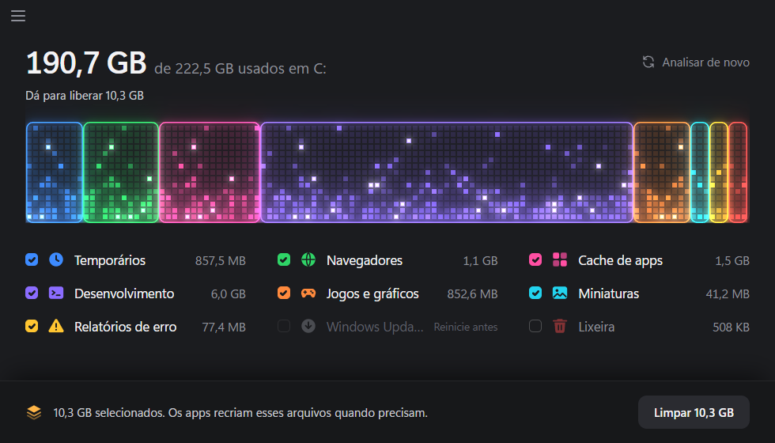
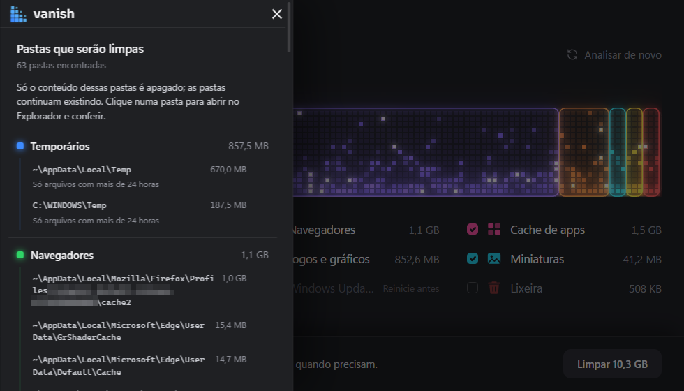

<div align="center">


# Vanish

**Limpa arquivos temporários e caches do Windows, mostrando antes exatamente o que vai sumir.**

Electron · TypeScript · Windows 10/11

</div>



## Por que o Vanish

Limpadores costumam ser uma caixa-preta: você clica e espera que não tenham apagado nada importante.
O Vanish faz o contrário:

- **Lista fechada e auditada.** Só apaga caches e temporários conhecidos, cada pasta revisada com
  fonte na [auditoria de segurança](docs/SAFETY-AUDIT.md).
- **Você vê as pastas reais.** O menu ☰ mostra cada pasta encontrada no seu PC, com o tamanho e a
  regra que se aplica; um clique abre no Explorador para conferir.
- **Confirmação que explica.** Antes de apagar, cada categoria aparece com o que vai acontecer
  ("Feche os navegadores antes"). O que não volta, como a Lixeira, pede "Entendi".
- **Travas de segurança.** Nunca segue atalhos ou junções para fora das pastas, pula arquivos em
  uso, mantém temporários recentes e bloqueia o Windows Update quando há atualização esperando
  reiniciar.



## O que ele limpa

| Categoria | O que entra | Começa marcada? |
|---|---|---|
| **Temporários** | `%TEMP%` e `C:\Windows\Temp`, só arquivos com mais de 24 h | sim |
| **Navegadores** | cache do Chrome, Edge, Brave, Opera e Firefox (senhas, histórico e logins ficam) | sim |
| **Cache de apps** | Discord, VS Code, Slack, Teams, Spotify, Notion, Obsidian, Postman | sim |
| **Desenvolvimento** | cache do npm, Yarn, pip, NuGet, Go e Electron | sim |
| **Jogos e gráficos** | shaders do DirectX, NVIDIA e AMD; cache web da Steam e da Epic | sim |
| **Miniaturas** | `thumbcache_*.db` e `iconcache_*.db` do Explorador | sim |
| **Relatórios de erro** | relatórios e despejos de travamentos antigos | sim |
| **Windows Update** | downloads de atualizações já instaladas | **não** (e bloqueado com reinício pendente) |
| **Lixeira** | tudo o que está na lixeira, em todos os discos | **não** |

O que ficou de fora de propósito (e por quê) está em [candidatos](docs/CLEANUP-CANDIDATES.md).

## Começando

Requisitos: **Windows 10 ou 11** e **Node.js 22+**.

```bash
npm install     # só na primeira vez
npm start       # compila e abre o app
```

- O app analisa sozinho ao abrir. Marque ou desmarque categorias, confira as pastas no ☰ e clique
  em **Limpar**.
- Algumas pastas (`C:\Windows\Temp`, Windows Update, parte dos relatórios de erro) só podem ser
  apagadas abrindo o terminal **como administrador** antes do `npm start`.
- Feche o app antes de rodar `npm start` de novo: uma janela antiga aberta continua com a versão
  antiga.

### Scripts

| Comando | O que faz |
|---|---|
| `npm start` | compila e abre o app |
| `npm test` | testes: regras de segurança de todas as categorias e o motor de limpeza em pastas falsas |
| `npm run typecheck` | confere os tipos (TypeScript estrito) |
| `npm run build` | só compila para `dist/` |
| `npm run logo` / `npm run icon` | regeneram o símbolo (`assets/*.svg`) e o ícone (`assets/icon.png`) |

## Como é feito

O app roda em três partes isoladas do Electron: a **tela** (sem acesso ao disco), uma **ponte**
que só deixa passar pedidos conhecidos e o **motor** no processo principal, que é o único que
mexe em arquivos. A tela nunca consegue pedir para apagar algo fora da lista.

```
src/
├── cleaner/        o motor: categorias (um arquivo cada), análise, limpeza, travas
├── main/           processo principal: janela e comunicação
├── preload/        ponte segura entre tela e motor
├── renderer/       a tela: barra de pixels, menu, confirmação, estilos
└── shared/         tipos usados pelos dois lados
tests/              testes de segurança das categorias e do motor
docs/               documentação
```

Detalhes em [arquitetura](docs/ARCHITECTURE.md).

## Adicionando lugares para limpar

Cada categoria é **um arquivo** em `src/cleaner/categories/`. Para incluir uma pasta nova, siga o
[guia de manutenção](docs/MAINTENANCE.md). Em resumo: confirme em fonte que é seguro, adicione no
arquivo da categoria, registre na auditoria e rode `npm test`. O teste **recusa** pastas fora das
áreas permitidas, pastas do sistema e dados do usuário.

## Documentação

| Arquivo | Conteúdo |
|---|---|
| [MAINTENANCE.md](docs/MAINTENANCE.md) | como adicionar pastas e categorias; o que o `npm test` confere |
| [ARCHITECTURE.md](docs/ARCHITECTURE.md) | estrutura de pastas, comunicação entre processos, fluxos |
| [SAFETY-AUDIT.md](docs/SAFETY-AUDIT.md) | o que é apagado, riscos, proteções e fontes de cada pasta |
| [CLEANUP-CANDIDATES.md](docs/CLEANUP-CANDIDATES.md) | outras coisas que podem (ou não devem) ser limpas |
| [DESIGN.md](docs/DESIGN.md) | identidade visual, animações, marca e textos |
| [ROADMAP.md](docs/ROADMAP.md) | o que já foi feito e o que vem depois |
| [AGENTS.md](AGENTS.md) | regras para quem (pessoa ou IA) for mexer no código |

## Licença

Código sob a licença **ISC** (veja `package.json`). A fonte **Sora**, usada no nome do app, é
distribuída sob a SIL Open Font License 1.1 (`src/renderer/fonts/OFL-Sora.txt`).
